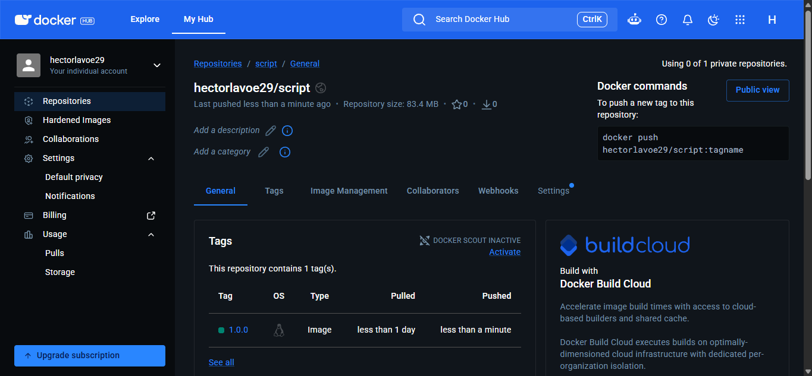

# Procesador de Portafolio de Inversiones en Docker

Proyecto contenedorizado en Python que limpia, transforma y agrega métricas financieras (ROI, ganancia neta y capital total por activo) a partir de un archivo CSV de inversiones, utilizando rutas y filtros configurables mediante variables de entorno y volúmenes Docker.

## Imagen disponible en Docker Hub

La imagen publicada se puede consultar y descargar desde:

**[hectorlavoe29/script en Docker Hub](https://hub.docker.com/repository/docker/hectorlavoe29/script/general)**



## Estructura del Proyecto

```text
.
├── data/
│   ├── input/
│   │   └── inversiones.csv       # Dataset ficticio de entrada
│   └── output/                   # Directorio donde se exporta el resultado
├── .dockerignore                 # Exclusiones para el contexto de construcción
├── .gitignore                    # Exclusiones para control de versiones en Git
├── Dockerfile                    # Definición multi-capa optimizada y segura
├── process_investments.py        # Script principal de procesamiento con pandas
├── requirements.txt              # Dependencias con versiones fijas
└── README.md                     # Documentación de uso y despliegue
```

## Variables de Entorno

El comportamiento del contenedor se configura externamente sin modificar el código fuente:

| Variable | Descripción | Valor por defecto |
| :--- | :--- | :--- |
| `INPUT_PATH` | Ruta interna del archivo CSV de entrada dentro del contenedor. | `/data/input/inversiones.csv` |
| `OUTPUT_PATH` | Ruta interna donde se guardará el CSV procesado. | `/data/output/resumen_inversiones.csv` |
| `MIN_INVESTMENT_USD` | Filtro opcional para procesar solo operaciones mayores o iguales a este monto. | `0` |

> **Nota sobre puertos:** Este contenedor ejecuta un proceso batch (ETL/procesamiento de datos) y finaliza tras generar el archivo de salida, por lo que **no expone puertos de red**.

## Uso para otros usuarios

1. Instala Docker Desktop o Docker Engine.
2. Descarga la imagen publicada:

   ```bash
   docker pull hectorlavoe29/script:1.0.0
   ```

3. Coloca el archivo CSV que deseas procesar en `data/input/`. Por ejemplo, usa `data/input/inversiones.csv`.
4. Ejecuta el contenedor desde la raíz del repositorio.

### En Linux / macOS / WSL2 (Bash)

```bash
docker run --rm \
  -v "$(pwd)/data/input:/data/input:ro" \
  -v "$(pwd)/data/output:/data/output" \
  -e MIN_INVESTMENT_USD=500 \
  hectorlavoe29/script:1.0.0
```

### En Windows (PowerShell)

```powershell
docker run --rm `
  -v "${PWD}/data/input:/data/input:ro" `
  -v "${PWD}/data/output:/data/output" `
  -e MIN_INVESTMENT_USD=500 `
  hectorlavoe29/script:1.0.0
```

Después de finalizar, el resultado se creará en `data/output/resumen_inversiones.csv`.

### Construcción opcional desde el código fuente

Las personas que quieran construir la imagen por sí mismas pueden ejecutar desde la raíz del proyecto:

```bash
docker build -t hectorlavoe29/script:1.0.0 .
docker run --rm \
  -v "$(pwd)/data/input:/data/input:ro" \
  -v "$(pwd)/data/output:/data/output" \
  hectorlavoe29/script:1.0.0
```

## Ejemplo de Salida Esperada

Al ejecutar el contenedor con los datos de ejemplo (`inversiones.csv`), la consola mostrará el resumen y creará `data/output/resumen_inversiones.csv`:

```text
[INFO] Leyendo datos desde: /data/input/inversiones.csv
[INFO] Registros iniciales: 52 | Registros válidos procesados: 50
[INFO] Resumen exportado exitosamente en: /data/output/resumen_inversiones.csv

--- Vista previa del resumen generado ---
 ticker     categoria  total_operaciones  capital_invertido_usd  valor_portafolio_usd  ganancia_neta_usd  roi_promedio_pct
   NVDA Acciones Tech                  9               27503.41              32110.85            4607.44             17.82
   SKYY     ETF Cloud                  8               21430.12              24890.50            3460.38             15.40
```
